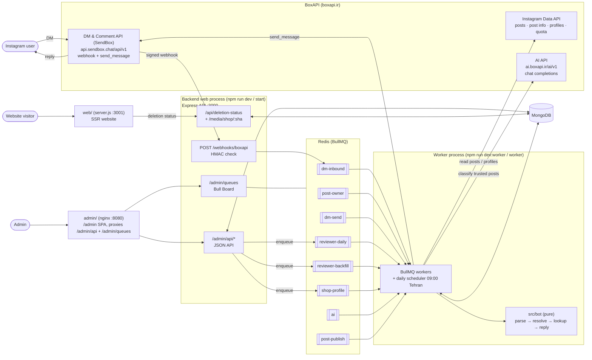
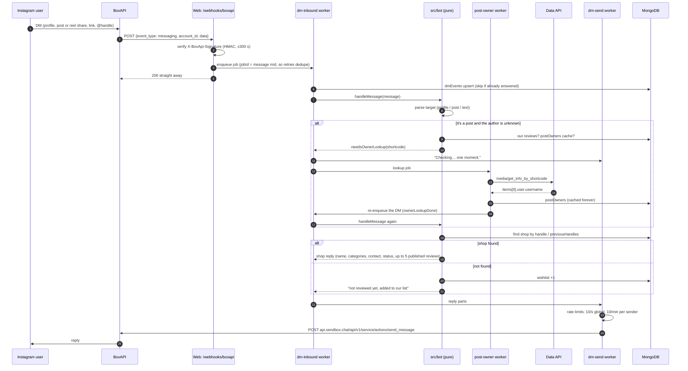
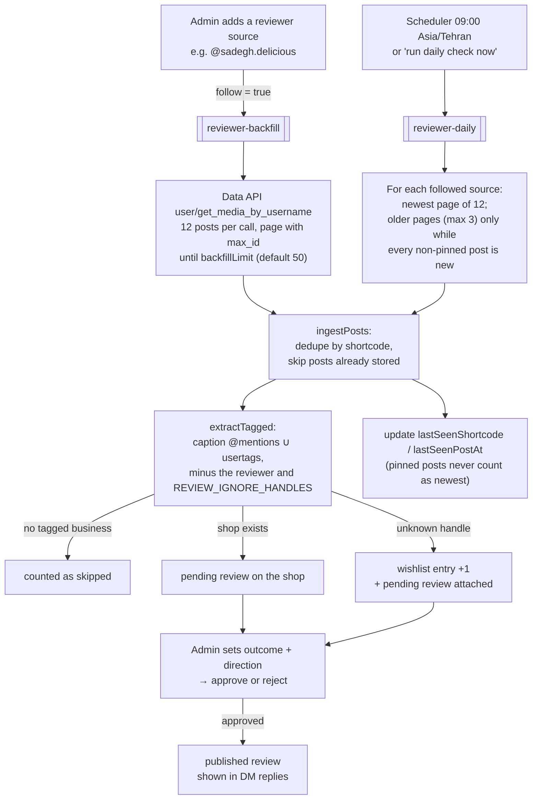
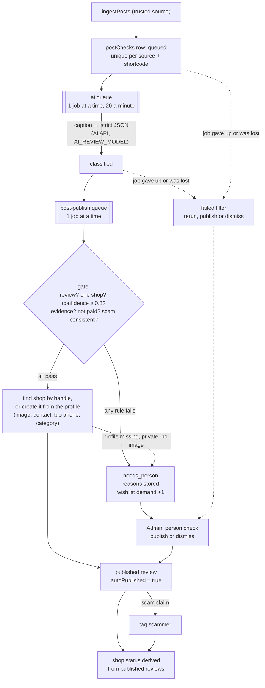
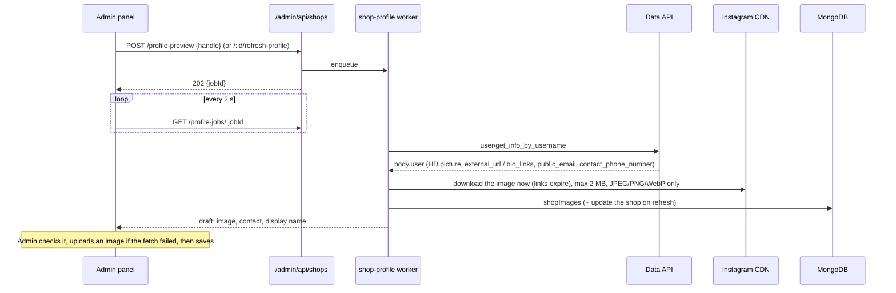
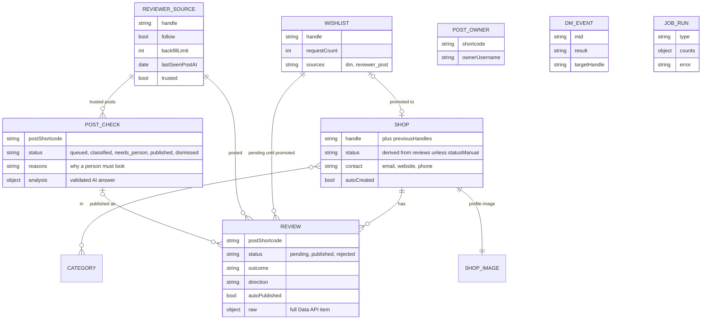

# How pagesanj works

A snapshot of the system as of 2026-10-30, after the BoxAPI migration (PRD §14 M5) and trusted reviewer pages (PRD §6.4). The spec is `PRD.md`; this file is the map.

pagesanj does three things:

1. **DM bot.** Someone sends our Instagram account a shop's page, post or `@handle`, and the bot replies with what we know about that shop.
2. **Daily reviewer check.** Every morning we read new posts from reviewer pages we follow. Each shop tagged in a post becomes a **pending review**, and an admin approves or rejects it. Posts of **trusted** pages are checked by an AI model instead and clear ones publish on their own.
3. **Website and admin panel.** A public bilingual (fa/en) site, and an admin panel where all moderation happens.

Instagram and AI are reached **only through BoxAPI** (boxapi.ir). We have no Meta app, no Graph API token and no scraper.

## 1. The big picture



The backend has **two Node processes** that share MongoDB and Redis. The website and admin app are separate services (§6).

| Process | Entry | Does |
|---|---|---|
| Web | `backend/src/server.ts` → `app.ts` | Receives webhooks, serves the admin JSON API, Bull Board, shop images and the public deletion-status API. It never calls Instagram itself: slow work goes into a queue. |
| Worker | `backend/src/worker.ts` | Runs every queue's worker and registers the daily scheduler. All BoxAPI calls happen here. |

## 2. Feature 1: the DM bot



Rules the bot always follows (PRD §5.2, §5.5):

- A shared **post** is answered about its **author**, never about the accounts tagged in it.
- It only replies to people who messaged first. Echoes of our own messages are ignored. A message is never answered twice: the job ids come from the `mid`, and a `dmEvents` row that already has a result is skipped.
- Persian by default; English when the message is mostly Latin script.

Code: `routes/webhooks.ts`, `boxapi/signature.ts`, `queues/workers/{dmInbound,postOwner,dmSend}.worker.ts`, `bot/*`, `services/botDeps.ts`, `services/postOwners.ts`, `boxapi/dm.ts`.

## 3. Feature 2: the daily reviewer check



- One failing source (for example a renamed page) is counted in `sourceErrors` and doesn't stop the others. The job fails only if every source fails.
- Every run writes a `jobRuns` row with its counts. The admin Jobs page shows those rows next to the BoxAPI request quota (`GET /api/my`).
- Nothing is published without an admin's approval, except clear reviews from trusted reviewer pages (next section). Admins never have outcome and direction guessed for them outside that flow.

Code: `services/reviewerPosts.ts`, `services/reviews.ts`, `boxapi/posts.ts`, `queues/workers/reviewer{Daily,Backfill}.worker.ts`, `queues/schedulers.ts`.

### Trusted reviewer pages

A reviewer source with `trusted: true` skips the pending-review path above. Every post (tagged or not) is stored as a `postChecks` row and goes through two queues (PRD §6.4):



- **The gate is pure** (`services/postGate.ts`): it collects every failed rule so the admin sees all the reasons. A handle must appear whole in the post (`vebo` doesn't match `vebo.ir`), and only the gate sets `scam_reported`. `services/postPublish.ts` adds `source_not_trusted`, `review_pending` and `review_rejected`, and does the shop, review, tag and status steps. Each step can run again, so a crashed job retries from the top.
- **Shop status** (`services/shopStatus.ts`): all published reviews positive is `recommended`, all negative `warning`, a mix `mixed`, and the tag `scammer` always `serious_warning`. A shop with no published review and no `scammer` tag goes back to `no_known_issues`. A hand-set status (`statusManual`) is kept, except that `scammer` still wins.
- **Auto-created shops** (`services/autoShops.ts`) reuse the profile fetch of section 4 and keep a phone read from the bio. They are marked `autoCreated`; the admin action **not a shop** removes one, adds its handle to `ignoredHandles` and sends its posts back to `needs_person` with the reason `not_a_shop`. The gate reads `ignoredHandles` together with `REVIEW_IGNORE_HANDLES` and every reviewer source's handle.
- **Failures:** 429, 5xx, network errors and the AI API's 402 retry (8 attempts, exponential backoff from 60 s); other 4xx don't. Only a real not-found, private or no-image result goes to a person. `lastError` means failed for good: the worker writes it only on the final attempt. The failed filter shows `queued` and `classified` rows with `lastError` or with no update for 6 hours (a lost job), and one shared filter drives that list and the publish, dismiss and rerun actions. Rerun applies only to failed rows; a `classified` rerun runs only the publish step.
- **Data API quota:** a real quota error has never been seen, and there's no special case for one, so it follows the status code: 429 or 5xx retries, 402 or 403 goes to the failed filter, and a 400 or 404 on a profile lookup is read as `profile_not_found` and goes to a person (PRD §6.4 step 7).
- Posts from sources that aren't trusted never reach the AI.

Code: `services/postChecks.ts`, `services/postClassify.ts`, `services/postGate.ts`, `services/postPublish.ts`, `services/autoShops.ts`, `services/shopStatus.ts`, `boxapi/ai.ts`, `queues/workers/{ai,postPublish}.worker.ts`, `routes/admin/postChecks.ts`.

## 4. Shop profile fetch

When a shop is created, or an admin presses **refresh profile**:



Contact details come **only from the shop's own page**. A field the page no longer shows is cleared on refresh.

Code: `queues/workers/shopProfile.worker.ts`, `boxapi/profile.ts`, `lib/download.ts`, `routes/admin/shops.ts`, `admin/src/lib/profileJob.ts`.

## 5. Data (MongoDB)



Also `ignoredHandles` (accounts the gate never publishes about), `admins` and `loginAttempts` (admin login with TOTP, same formats as pagesanj) and `deletionRequests`.

## 6. Admin panel and website

- **Admin** (`admin/`, Vite + React at `/admin`, served by its own nginx image that proxies `/admin/api` and `/admin/queues` to the backend). The screens are pending reviews, person check (posts of trusted pages the gate held), wishlist, shops, categories, reviewer sources and jobs. Login needs a password plus a TOTP code, and every write needs a CSRF token. Bull Board is at `/admin/queues`.
- **Website** (`web/`, Vite + React SSR, rendered by its own server `web/server.js` at `/`; it asks the backend only for deletion statuses). It has the landing page and the legal pages Meta requires (`/privacy`, `/terms`, `/data-deletion` plus a deletion-status lookup), in fa (RTL, the default) and en.

## 7. Configuration

Backend config goes through `backend/src/config/env.ts`; the template is `backend/.env.example`. The website reads `CONTACT_EMAIL`, `SITE_INSTAGRAM_HANDLE`, `COMPANY_NAME` and `API_URL` (template `web/.env.example`); the admin image reads `BACKEND_URL`.

| Variable | For |
|---|---|
| `MONGODB_URI`, `REDIS_URL` | Data and queues (Redis must use `maxmemory-policy noeviction`). |
| `BOXAPI_INSTAGRAM_DM_TOKEN` | DM & Comment API (`X-Api-Key`): sending replies. |
| `BOXAPI_DM_BASE_URL` | DM API host. Defaults to `https://api.sendbox.chat/api/v1` (SendBox, BoxAPI's DM service outside Iran). |
| `BOXAPI_WEBHOOK_SECRET` | Checking webhook signatures. Until it's set, every webhook is rejected. |
| `BOXAPI_INSTAGRAM_TOKEN` | Data API (Bearer): posts, post owners, profiles, quota. |
| `BOXAPI_INSTAGRAM_BASE_URL` | Data API host. Defaults to `https://instagram.boxpi.ir`; **set it to `https://boxapi.ir`**, because our current token is only accepted there. |
| `BOXAPI_AI_TOKEN` | AI API (Bearer), host `https://ai.boxapi.ir/ai/v1`; `ai.boxpi.ir` rejects our key. Used to classify posts of trusted reviewer pages. |
| `BOXAPI_AI_BASE_URL` | AI API host. Defaults to `https://ai.boxapi.ir/ai/v1`. |
| `AI_REVIEW_MODEL` | Model that classifies trusted posts (default `openai/gpt-6-luna`). Changing it needs no code change. |
| `AI_PUBLISH_MIN_CONFIDENCE` | Lowest AI confidence that can auto-publish (default `0.8`). |
| `REVIEW_IGNORE_HANDLES` | Tagged handles that aren't shops (sponsors). Also applies to handles the AI names; the `ignoredHandles` collection and every reviewer source's handle add to it. |
| `DAILY_CHECK_CRON` | Daily check time (default `0 9 * * *`, Asia/Tehran). |
| `SESSION_SECRET`, `DATA_ENCRYPTION_KEY` | Admin sessions; encryption key shared with pagesanj. |

> **AI key limits:** one request at a time and 20 a minute, so the `ai` queue runs one job at a time with a 20 a minute limiter. `GET /ai/v1/me` shows the key's own credit.

> **Quota:** the BoxAPI Data API plan is small (10 requests a month at the time of writing). Each backfill page, daily-check page, post-owner lookup and profile fetch uses one request. The Jobs page shows what's left.

## 8. Running it

```bash
npm install
npm run dev          # web process  → http://localhost:3000
npm run dev:worker   # worker process (needed for replies, lookups, daily check, trusted-post AI)
npm run dev:admin    # admin panel dev server
npm run dev:web      # website dev server
npm test             # backend tests (vitest, in-memory MongoDB) and website server tests

docker compose up -d --build   # backend :3000, worker, web :3001, admin :8080, MongoDB, Redis
```

On a network where Node can't reach Instagram's CDN directly (the profile image download), start the worker with `NODE_USE_ENV_PROXY=1` and a `NO_PROXY` that covers the BoxAPI hosts, so only the CDN goes through the proxy.

## 9. Deploying on Hamravesh (Kubernetes)

Hamravesh runs each part as its own app, the same way `docker-compose.yml` runs them side by side. Six apps in one namespace:

| App | Image | Command | Port | Public domain | Health check |
|---|---|---|---|---|---|
| `mongo` | MongoDB 7 (managed / one-click) | n/a | 27017 | no | built in |
| `redis` | Redis 7 (managed / one-click) | n/a | 6379 | no | built in |
| `backend` | `pagesanj/backend` | default (`node dist/server.js`) | 3000 | yes, BoxAPI posts the webhook here | HTTP `GET /healthz` |
| `worker` | `pagesanj/backend` (**same image**) | `node dist/worker.js` | none | no | none (it serves no HTTP) |
| `web` | `pagesanj/web` | default (`node server.js`) | 3001 | yes, the public site | HTTP `GET /healthz` |
| `admin` | `pagesanj/admin` | default (nginx) | 8080 | yes, the panel at `/admin` | HTTP `GET /healthz` |

`backend` and `worker` never call each other. The API puts jobs into Redis and the workers take them out.

### Steps

1. **Build and push the images.** Every Dockerfile uses the repo root as its build context, so clone with submodules first:
   ```bash
   git clone --recurse-submodules <root repo> && cd pagesanj
   docker build -f backend/Dockerfile -t <registry>/pagesanj/backend:<tag> .
   docker build -f web/Dockerfile     -t <registry>/pagesanj/web:<tag> .
   docker build -f admin/Dockerfile   -t <registry>/pagesanj/admin:<tag> .
   docker push <registry>/pagesanj/backend:<tag>   # and the other two
   ```
   Push to Hamravesh's registry or any registry it can pull from. Building from git inside Hamravesh also works if it can fetch the submodules and lets you set the Dockerfile path and the root context.
2. **Redis.** Give it a persistent volume, AOF on (`appendonly yes`) and `maxmemory-policy noeviction`. BullMQ can lose jobs under any other eviction policy.
3. **MongoDB.** Give it a persistent volume, and turn on backups.
4. **`backend`.** Deploy from the backend image on port 3000. Set every variable from `backend/.env.example` (§7) as app secrets/env, with:
   - `MONGODB_URI` and `REDIS_URL` pointing at the internal addresses of the `mongo` and `redis` apps (the Hamravesh panel shows them).
   - `NODE_ENV=production`, `TRUST_PROXY=true` (it runs behind Hamravesh's ingress), `PUBLIC_BASE_URL=https://<web domain>`.
   - A domain with HTTPS.
5. **`worker`.** Create a second app from the **same backend image and tag**, with the **same env vars**, and override the command to `node dist/worker.js`. No port, no domain, no HTTP health check. Set the termination grace period to 30–60s: on `SIGTERM` the worker finishes its running jobs before it exits.
6. **`web`.** Deploy from the web image on port 3001 with the `web/.env.example` variables. Set `API_URL` to the backend's internal address (`http://<backend app>:3000`). Give it the public site domain.
7. **`admin`.** Deploy from the admin image on port 8080, with `BACKEND_URL` set to the backend's internal address. Give it a domain. nginx proxies `/admin/api` and `/admin/queues`, so the panel and API share one origin and the session cookie just works.
8. **First admin.** The admin scripts run through `tsx`, a dev dependency that isn't in the image, so run them from a dev checkout. Point `backend/.env` at the production `MONGODB_URI` (for example through a port-forward to the `mongo` app), set `ADMIN_PASSWORD` and `DATA_ENCRYPTION_KEY`, then run `npm run admin:create -- <username>`. To copy admins from pagesanj, run `npm run admin:import -- <username>` instead.
9. **BoxAPI.** Set the webhook URL in the BoxAPI/SendBox panel to `https://<backend domain>/webhooks/boxapi` and copy its secret into `BOXAPI_WEBHOOK_SECRET`. Until it's set, every webhook is rejected.
10. **Check.** `GET /healthz` on backend, web and admin. Send the Instagram account a DM and follow it through Bull Board (`/admin/queues`): `dm-inbound` → `post-owner` → `dm-send`.

> **Region:** the BoxAPI defaults assume the backend is **outside Iran** (PRD §10). If the Hamravesh apps run in an Iranian data centre, switch the hosts: `BOXAPI_DM_BASE_URL=https://boxapi.ir` (the DM API's Iran host) and `BOXAPI_INSTAGRAM_BASE_URL=https://boxapi.ir`. Update PRD §10 if that becomes the plan.

### Updating

Build and push a new tag, then point **both** `backend` and `worker` at it. They share models and queue payloads, so they should always run the same version.

### Scaling

- **More workers: raise `worker`'s replica count.** BullMQ locks each job in Redis, so each job runs on exactly one replica.
  - The daily scheduler is registered with a fixed id (`upsertJobScheduler`), so extra replicas don't create duplicate daily runs.
  - The `dm-send` limiter (10 sends/s) and the per-recipient send limit live in Redis, so they stay global however many replicas run.
  - `concurrency` is **per process**: `post-owner` and `shop-profile` run 2 jobs each per replica, so 3 replicas make 6 Data API calls at once. Check that against the BoxAPI plan and its quota (§7).
  - Most of the work is waiting on BoxAPI, so if one queue backs up, raise that worker's `concurrency` before adding replicas.
- **More API: raise `backend`'s replica count.** The web process holds no state in memory: admin sessions are signed cookies and everything else is in MongoDB or Redis.
- Run **one** MongoDB and **one** Redis. Every replica of every app shares them.
