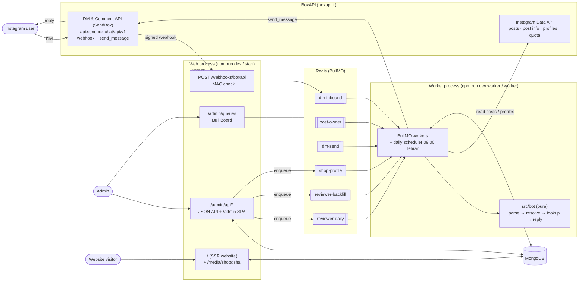
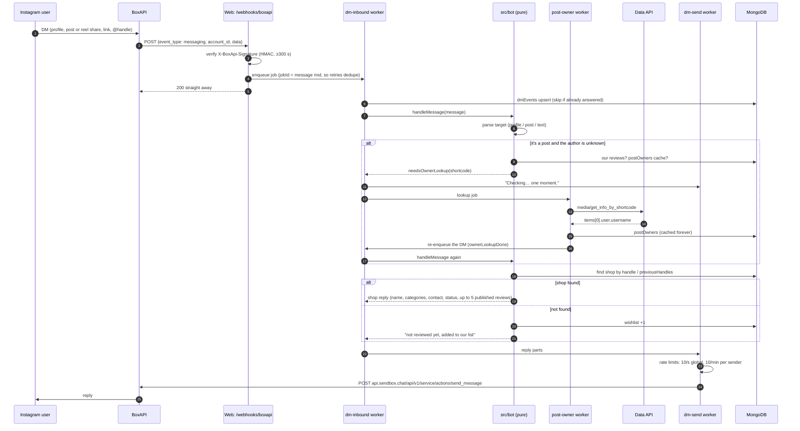
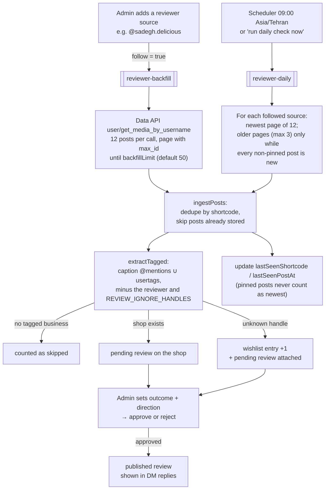
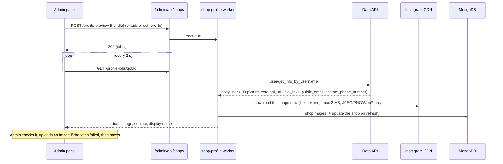
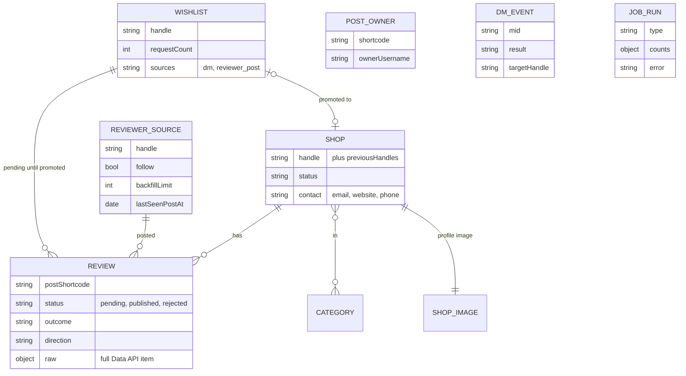

# How pagesanj works

A snapshot of the system as of 2026-10-29, after the BoxAPI migration (PRD §14 M5). The spec is `PRD.md`; this file is the map.

pagesanj does three things:

1. **DM bot.** Someone sends our Instagram account a shop's page, post or `@handle`, and the bot replies with what we know about that shop.
2. **Daily reviewer check.** Every morning we read new posts from reviewer pages we follow. Each shop tagged in a post becomes a **pending review**, and an admin approves or rejects it.
3. **Website and admin panel.** A public bilingual (fa/en) site, and an admin panel where all moderation happens.

Instagram and AI are reached **only through BoxAPI** (boxapi.ir). We have no Meta app, no Graph API token and no scraper.

## 1. The big picture



There are **two Node processes** that share MongoDB and Redis:

| Process | Entry | Does |
|---|---|---|
| Web | `backend/src/server.ts` → `app.ts` | Receives webhooks, serves the admin API and SPA, Bull Board and the SSR website. It never calls Instagram itself: slow work goes into a queue. |
| Worker | `backend/src/worker.ts` | Runs every queue's worker and registers the daily scheduler. All BoxAPI calls happen here. |

## 2. Feature 1: the DM bot



Rules the bot always follows (PRD §5.2, §5.5):

- A shared **post** is answered about its **author**, never about the accounts tagged in it.
- It only replies to people who messaged first. Echoes of our own messages are ignored. A message is never answered twice: the job ids come from the `mid`, and a `dmEvents` row that already has a result is skipped.
- Persian by default; English when the message is mostly Latin script.

Code: `routes/webhooks.ts`, `boxapi/signature.ts`, `queues/workers/{dmInbound,postOwner,dmSend}.worker.ts`, `bot/*`, `services/botDeps.ts`, `services/postOwners.ts`, `boxapi/dm.ts`.

## 3. Feature 2: the daily reviewer check



- One failing source (for example a renamed page) is counted in `sourceErrors` and doesn't stop the others. The job fails only if every source fails.
- Every run writes a `jobRuns` row with its counts. The admin Jobs page shows those rows next to the BoxAPI request quota (`GET /api/my`).
- Nothing is published without an admin's approval. Outcome and direction are never guessed.

Code: `services/reviewerPosts.ts`, `services/reviews.ts`, `boxapi/posts.ts`, `queues/workers/reviewer{Daily,Backfill}.worker.ts`, `queues/schedulers.ts`.

## 4. Shop profile fetch

When a shop is created, or an admin presses **refresh profile**:



Contact details come **only from the shop's own page**. A field the page no longer shows is cleared on refresh.

Code: `queues/workers/shopProfile.worker.ts`, `boxapi/profile.ts`, `lib/download.ts`, `routes/admin/shops.ts`, `admin/src/lib/profileJob.ts`.

## 5. Data (MongoDB)



Also `admins` and `loginAttempts` (admin login with TOTP, same formats as pagesanj) and `deletionRequests`.

## 6. Admin panel and website

- **Admin** (`admin/`, Vite + React, served at `/admin`). The screens are pending reviews, wishlist, shops, categories, reviewer sources and jobs. Login needs a password plus a TOTP code, and every write needs a CSRF token. Bull Board is at `/admin/queues`.
- **Website** (`web/`, Vite + React SSR, rendered by Express at `/`). It has the landing page and the legal pages Meta requires (`/privacy`, `/terms`, `/data-deletion` plus a deletion-status lookup), in fa (RTL, the default) and en.

## 7. Configuration

Everything goes through `backend/src/config/env.ts`; the template is `backend/.env.example`.

| Variable | For |
|---|---|
| `MONGODB_URI`, `REDIS_URL` | Data and queues (Redis must use `maxmemory-policy noeviction`). |
| `BOXAPI_INSTAGRAM_DM_TOKEN` | DM & Comment API (`X-Api-Key`): sending replies. |
| `BOXAPI_DM_BASE_URL` | DM API host. Defaults to `https://api.sendbox.chat/api/v1` (SendBox, BoxAPI's DM service outside Iran). |
| `BOXAPI_WEBHOOK_SECRET` | Checking webhook signatures. Until it's set, every webhook is rejected. |
| `BOXAPI_INSTAGRAM_TOKEN` | Data API (Bearer): posts, post owners, profiles, quota. |
| `BOXAPI_INSTAGRAM_BASE_URL` | Data API host. Defaults to `https://instagram.boxpi.ir`; **set it to `https://boxapi.ir`**, because our current token is only accepted there. |
| `BOXAPI_AI_TOKEN` | AI API (Jev models). Not used yet. |
| `REVIEW_IGNORE_HANDLES` | Tagged handles that aren't shops (sponsors). |
| `DAILY_CHECK_CRON` | Daily check time (default `0 9 * * *`, Asia/Tehran). |
| `SESSION_SECRET`, `DATA_ENCRYPTION_KEY` | Admin sessions; encryption key shared with pagesanj. |

> **Quota:** the BoxAPI Data API plan is small (10 requests a month at the time of writing). Each backfill page, daily-check page, post-owner lookup and profile fetch uses one request. The Jobs page shows what's left.

## 8. Running it

```bash
npm install
npm run dev          # web process  → http://localhost:3000
npm run dev:worker   # worker process (needed for replies, lookups, daily check)
npm run dev:admin    # admin panel dev server
npm run dev:web      # website dev server
npm test             # backend tests (vitest, in-memory MongoDB)
```
